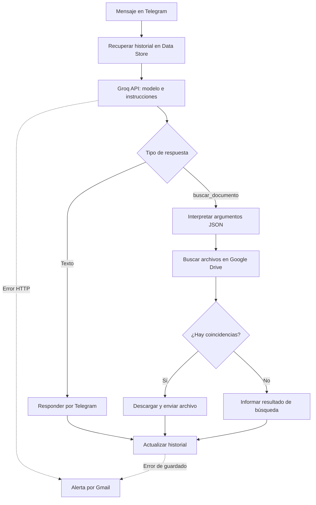

# Asistente de viaje con IA

**Asistente conversacional creado en Make para consultar información de un viaje y recuperar documentos desde Telegram.**

Desarrollé este proyecto personal para explorar cómo combinar **automatización low-code, modelos de lenguaje e integración de servicios** en una experiencia sencilla para el usuario: hacer una pregunta por Telegram y recibir una respuesta sobre el itinerario o solicitar un archivo sin tener que buscarlo manualmente en una carpeta.

El escenario integra **Make, Telegram, Groq, Google Drive, Make Data Store y Gmail**, con un modelo de IA configurado a través de la API de Groq (`openai/gpt-oss-120b`).

## El problema

Los datos importantes de un viaje suelen estar distribuidos entre reservas, boletos, comprobantes y anotaciones. En lugar de consultar varias fuentes por separado, el asistente utiliza Telegram como punto de acceso a dos tipos de información:

- **Itinerario del viaje:** información incorporada previamente al contexto del asistente para responder preguntas generales.
- **Documentos de viaje:** archivos disponibles en una carpeta determinada de Google Drive, que Make puede buscar y enviar a Telegram.

## Funcionalidades

- **Conversación sobre el viaje:** respuestas basadas en el itinerario previamente configurado.
- **Identificación de solicitudes de archivos:** la IA distingue las consultas informativas de las peticiones de documentos.
- **Function calling:** el modelo genera argumentos estructurados para la herramienta `buscar_documento`; Make interpreta esa solicitud y ejecuta la búsqueda.
- **Integración con Google Drive:** consulta archivos por nombre dentro de una carpeta específica y recupera los documentos coincidentes.
- **Entrega por Telegram:** respuestas de texto, documentos y mensajes cuando una búsqueda no devuelve coincidencias.
- **Contexto conversacional:** historial almacenado por chat mediante Make Data Store para interpretar consultas sucesivas.
- **Alertas operativas:** avisos por Gmail ante determinados errores del servicio de IA o del almacenamiento del historial.

## Arquitectura



El modelo no se conecta directamente a Google Drive. Su función es interpretar la intención y proponer los parámetros de la herramienta; **Make orquesta la ejecución**, consulta Drive y envía el resultado.

## Tecnologías utilizadas

| Tecnología | Aplicación en el proyecto |
|---|---|
| **Make** | Orquestación del escenario, routers, filtros y gestión de módulos |
| **Telegram Bot** | Interfaz conversacional y envío de archivos |
| **Groq API** | Acceso al modelo de lenguaje mediante peticiones HTTP |
| **`openai/gpt-oss-120b`** | Modelo configurado para interpretar consultas y generar llamadas a herramientas |
| **Google Drive API v3** | Búsqueda y recuperación de documentos de una carpeta |
| **Make Data Store** | Persistencia del historial de conversación por chat |
| **Gmail** | Notificaciones de determinados errores |

## Ejemplos de interacción

*Los ejemplos utilizan un itinerario y nombres ficticios.*

| Consulta por Telegram | Respuesta del escenario |
|---|---|
| «¿Qué transporte tenemos entre Lisboa y Oporto?» | Consulta el contexto precargado y formula la respuesta |
| «Enviame el boleto de tren» | Solicita `buscar_documento` y comienza la búsqueda en Drive |
| «El de Ana» | Utiliza el historial para interpretar a qué documento se refiere la aclaración |
| Solicitud sin coincidencias | Envía un mensaje indicando que no se encontró el archivo |

La búsqueda actual se realiza **a partir del nombre de los archivos**, no mediante lectura del contenido de los PDF. El itinerario se configura en las instrucciones del asistente y no se sincroniza automáticamente desde Drive. Estos criterios forman parte del diseño de esta versión.

## Explorar o reproducir el proyecto

El repositorio incluye un [blueprint público de Make](blueprints/asistente-viaje.public.blueprint.json), con datos ficticios y marcadores de configuración. El escenario original fue adaptado para compartir su arquitectura sin incluir credenciales, datos de viajeros ni reservas reales.

Para ponerlo en marcha en otra cuenta:

1. Importar el blueprint en un escenario nuevo de Make.
2. Reconectar los servicios de Telegram, Google Drive y Gmail, además del webhook y el Data Store.
3. Configurar una credencial propia de Groq y un itinerario de prueba.
4. Indicar la carpeta de Google Drive y cargar documentos de demostración.
5. Validar las consultas y el envío de archivos con los casos de prueba del repositorio.

El detalle de configuración se encuentra en [docs/CONFIGURACION.md](docs/CONFIGURACION.md).

## Documentación

- [Arquitectura técnica](docs/ARQUITECTURA.md): módulos, rutas y funcionamiento de la herramienta.
- [Configuración](docs/CONFIGURACION.md): importación y conexiones necesarias.
- [Plan de pruebas](docs/PRUEBAS.md): escenarios de validación funcional.
- [Roadmap](docs/ROADMAP.md): posibles líneas de evolución.
- [Ejemplo de itinerario ficticio](examples/itinerario-ficticio.md) y [nombres de archivos](examples/nombres-archivos.txt).

## Validación del blueprint

Incluí un script y pruebas unitarias para verificar de forma **estática** la estructura del JSON, los módulos principales, la definición de `buscar_documento` y algunos patrones habituales de credenciales. También se ejecutan con GitHub Actions.

```bash
python3 scripts/check_blueprint.py
python3 -m unittest discover -s tests -v
```

Estas verificaciones son independientes de Make y no sustituyen las pruebas funcionales con las conexiones configuradas.

## Evolución

La hoja de ruta contempla mejoras en la gestión de documentos, la administración de itinerarios, los controles de acceso y la posibilidad de ampliar el asistente a más viajeros y viajes. Las próximas líneas de trabajo están descritas en el [roadmap](docs/ROADMAP.md).

---

**Proyecto personal de automatización e IA aplicada.** Su objetivo es mostrar la integración de herramientas, el diseño de un flujo conversacional y la utilización de *function calling* para conectar un modelo de lenguaje con acciones concretas en Make.
