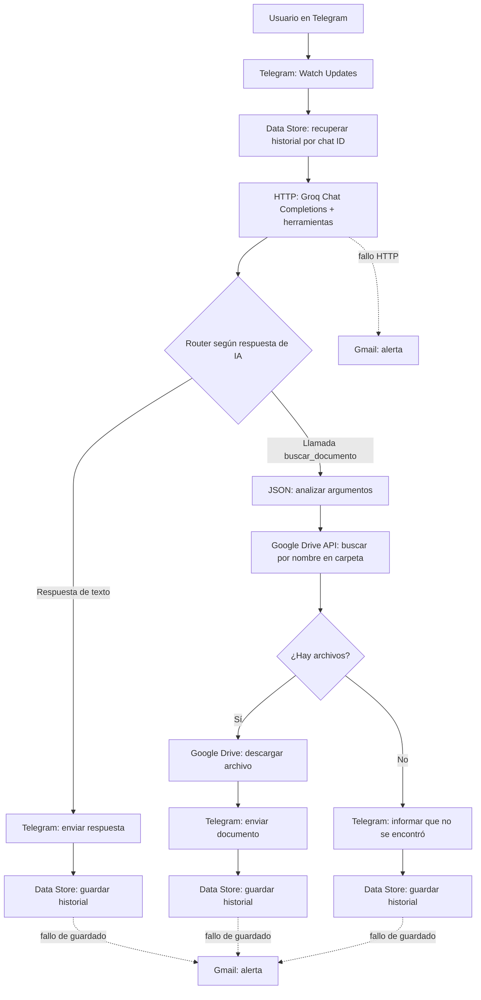

# Asistente de viaje con IA · Make + Telegram + Google Drive

**Automatización conversacional para consultar un itinerario y solicitar documentos de viaje desde Telegram.**

Proyecto personal / demostración técnica desarrollado sobre **Make**. Integra **Groq (modelo `openai/gpt-oss-120b`)**, **Telegram**, **Google Drive**, **Make Data Store** y **Gmail**. El asistente identifica cuándo responder una pregunta sobre el itinerario y cuándo solicitar a Make la recuperación de un archivo mediante *function calling*.


## Problema que resuelve

Durante un viaje, las reservas y los boletos suelen estar repartidos entre carpetas y correos, y resulta difícil encontrar el documento oportuno o recordar un horario. Este escenario centraliza el acceso a la **información precargada de un itinerario** y a una **carpeta designada de Google Drive**, usando Telegram como interfaz.

**Consultas de ejemplo:**

- «¿Qué transporte tenemos entre Lisboa y Oporto?» → El modelo responde con la información precargada.
- «Enviame el boleto de tren a Oporto» → El modelo solicita `buscar_documento`; Make busca por nombre de archivo, descarga el resultado y lo envía por Telegram.
- «El de Ana» → El modelo intenta interpretar la aclaración con el historial del chat.
- Si la búsqueda no arroja resultados, el bot informa que no encontró coincidencias.

## Arquitectura del escenario



La herramienta `buscar_documento` **no se ejecuta dentro del modelo**: el modelo devuelve una llamada estructurada y **Make** la implementa con su conexión a Google Drive. Es *tool/function calling orquestado en Make*.

## Tecnologías y responsabilidades

| Componente | Función en el flujo |
|---|---|
| Make | Orquestación, filtros, rutas, manejo básico de errores |
| Telegram Bot | Entrada de mensajes; salida de respuestas y archivos |
| Groq API | Clasificación de intención, respuesta basada en el itinerario y extracción de criterios mediante tool calling |
| `openai/gpt-oss-120b` | Modelo configurado en el blueprint revisado; sujeto a disponibilidad del proveedor |
| Google Drive API v3 | Localización de archivos **por nombre** dentro de una carpeta específica |
| Make Data Store | Historial en texto por identificador de chat |
| Gmail | Notificaciones configuradas ante fallos de IA o escritura de historial |

## Qué hace y qué no hace

**Implementado en el diseño:** diálogo con contexto precargado, solicitudes de documentos mediante parámetros estructurados, búsqueda en Drive, envío por Telegram, historial por conversación y determinadas alertas.

**No implementado en este blueprint:** leer o comprender el interior de PDFs; OCR; RAG o búsqueda vectorial; sincronización automática del itinerario desde Google Drive; validación explícita de usuarios autorizados; resolución robusta de archivos duplicados; batería de pruebas de extremo a extremo.

El itinerario está **escrito dentro del mensaje de sistema enviado a Groq**. No se extrae dinámicamente de los boletos, reservas ni documentos de Drive. La capacidad de recuperación de archivos depende de cómo se nombren los archivos.

## Ejecutar una copia

1. Crear un escenario nuevo en Make e importar [`blueprints/asistente-viaje.public.blueprint.json`](blueprints/asistente-viaje.public.blueprint.json). Es una **plantilla anonimizada**, no una configuración lista para producción.
2. Crear o reconectar Telegram, Google Drive y Gmail, además del Data Store y el webhook. Colocar una clave **nueva** de Groq mediante un método de autenticación seguro compatible con Make.
3. En el módulo HTTP, sustituir el itinerario de ejemplo por información propia; en la búsqueda de Drive, ajustar el ID de carpeta y la convención de nombres de archivos.
4. Aplicar controles de autorización y revisar las limitaciones antes de habilitar el bot. Validar con los casos de [`docs/PRUEBAS.md`](docs/PRUEBAS.md).

Guía detallada: **[`docs/CONFIGURACION.md`](docs/CONFIGURACION.md)**. La documentación oficial de Make aclara que, después de importar un blueprint, hay que configurar las conexiones propias: [Scenario blueprints](https://help.make.com/blueprints).

## Estructura del repositorio

```text
travel-assistant-make/
├── README.md
├── blueprints/
│   └── asistente-viaje.public.blueprint.json   # Export anonimizado; requiere configuración
├── docs/
│   ├── ARQUITECTURA.md
│   ├── CONFIGURACION.md
│   ├── PRUEBAS.md
│   └── ROADMAP.md
├── examples/
│   ├── itinerario-ficticio.md
│   └── nombres-archivos.txt
├── scripts/
│   └── check_blueprint.py
├── tests/
│   └── test_blueprint.py
├── .github/workflows/
│   └── validar.yml
├── .gitignore
└── CHANGELOG.md
```

## Control de calidad local

Se incluye una comprobación **estática y offline** del JSON, su topología básica y algunos patrones de credenciales:

```bash
python3 scripts/check_blueprint.py
python3 -m unittest discover -s tests -v
```

Estas pruebas **no** prueban funcionamiento real de las APIs ni seguridad integral. La integración solo puede verificarse en un entorno Make configurado.

## Autoría y alcance

Proyecto de aprendizaje y portfolio sobre automatización de procesos con herramientas low-code e inteligencia artificial.

